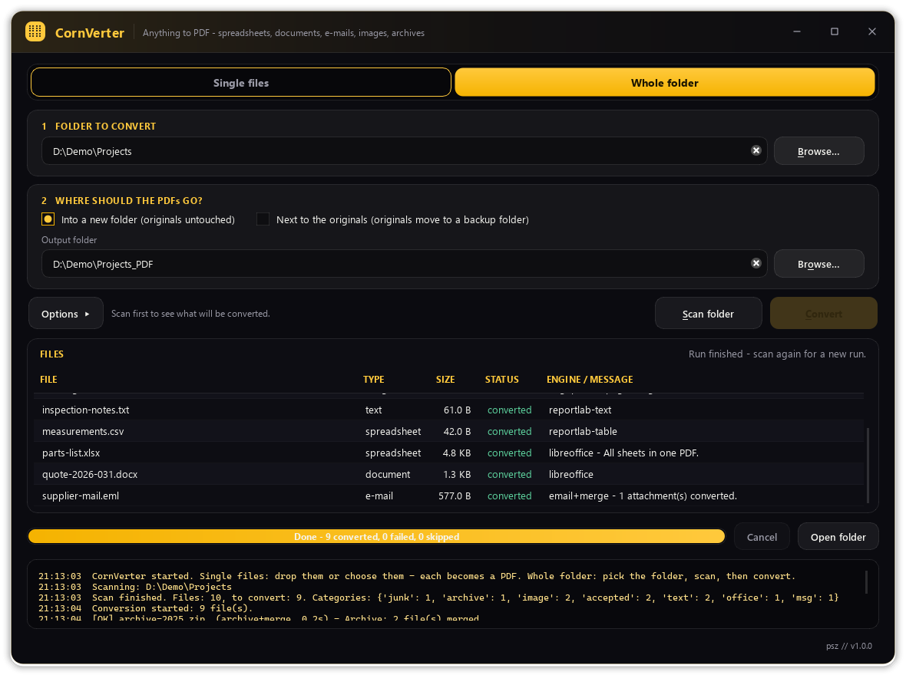
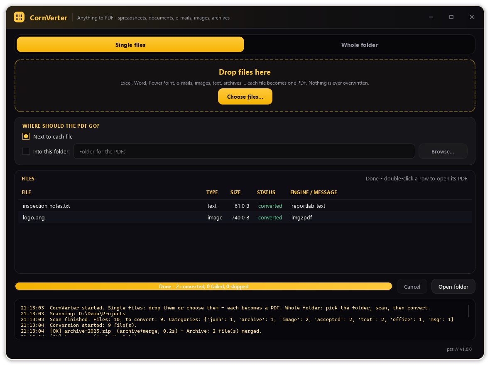
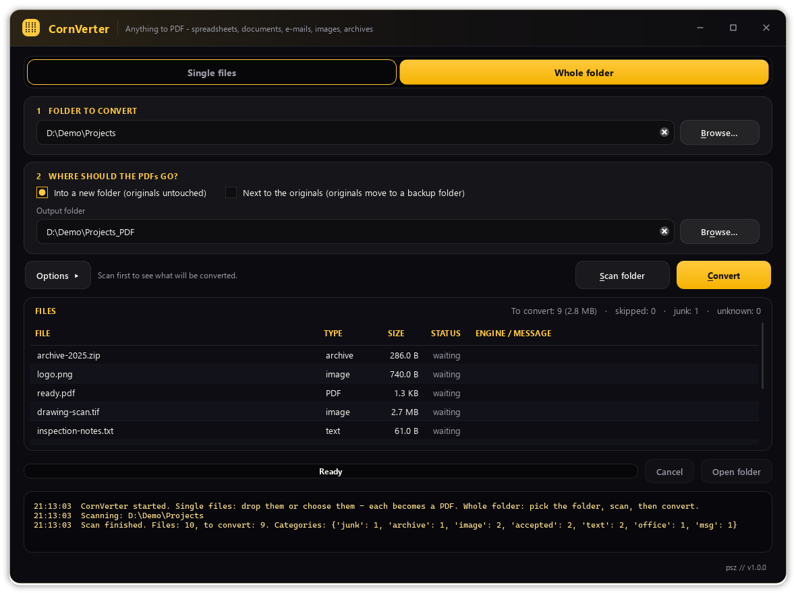
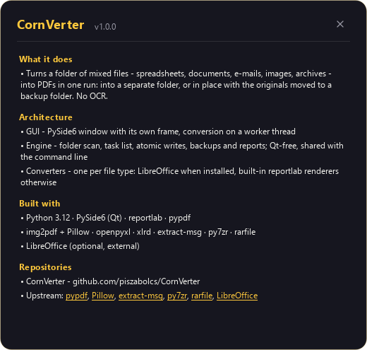
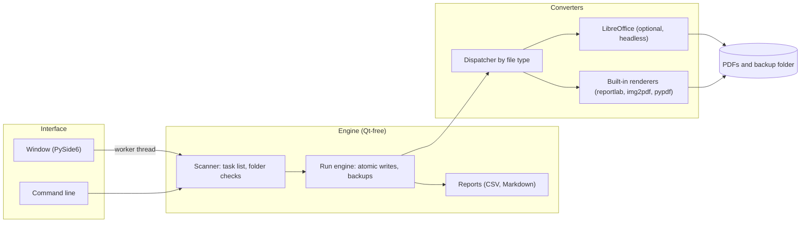

<div align="center">


# CornVerter

**Turn a folder of office files, e-mails, scans and archives into PDFs in one local run**


[Features](#features) · [Screenshots](#screenshots) · [Architecture](#architecture) · [Installation](#installation)

</div>

<p align="center">
  
</p>

## The problem

PDF is the one format every archive, document indexer and AI knowledge base accepts, but a real project
folder holds spreadsheets, Word and PowerPoint files, Outlook e-mails, scans and zip files side by side.
Converting them one by one takes hours, online converters mean uploading internal documents, and a batch
job that overwrites files or loses an original is worse than doing it by hand.

## The solution

CornVerter converts a whole folder tree, or a few dropped files, to PDF in one run on the local machine.
It uses LibreOffice when it is installed and built-in renderers when it is not, and it merges e-mail
attachments and archive contents into one PDF per item. Every conversion goes into a work file first, only
a PDF that opens correctly takes the final name, and an original is moved to a backup folder only after
that. Each run writes a CSV log and a Markdown summary.

## Features

- **Three ways in.** A folder into a separate output folder (mirrored tree, originals untouched), a folder in place (originals moved to `<folder>_originals`), or single dropped files with the PDF next to each.
- **Two engines.** LibreOffice keeps the formatting when it is installed; built-in renderers keep the content when it is not.
- **Spreadsheets in full.** Every sheet goes into one PDF, columns are widened to their content and the result is checked for cut-off `###` cells.
- **E-mails with attachments.** `.msg` and `.eml` become header and body, with every attachment converted and merged into the same PDF.
- **Images and archives.** One page per image or TIF frame (JPEG and CCITT G4 without re-encoding); `.zip`, `.7z`, `.rar`, `.tar` and `.gz` are unpacked with safety limits and merged.
- **Nothing lost.** Atomic writes, a PDF check before the final name, no silent overwrites, and links or junctions are never followed.
- **Run reports.** Every run writes a timestamped CSV log and a Markdown summary.
- **Command line.** The same Qt-free engine for scripts and scheduled jobs.

## Screenshots

<table>
  <tr>
    <td align="center" width="50%"><br/><sub>Single files: drop files, each becomes a PDF</sub></td>
    <td align="center" width="50%"><br/><sub>Whole folder: the scan shows what will be converted</sub></td>
  </tr>
  <tr>
    <td align="center" colspan="2"><br/><sub>About card</sub></td>
  </tr>
</table>

The screenshots are made offscreen from generated demo data by `tools/make_screenshots.py`.

## Architecture



The engine has no Qt dependency: it scans the folder, builds the task list, writes every PDF through a
work file and moves originals to the backup folder. The window runs it on a worker thread, and the command
line calls it directly. Each file type has its own converter module behind one dispatcher, which tries
LibreOffice first (with its own profile and a 240 s limit per file) and falls back to the built-in
renderers.

## Tech stack

| Layer | Technology |
|---|---|
| Language | Python 3.12 |
| Desktop UI | PySide6 (Qt 6) with its own window frame, `QThread` worker |
| PDF output | reportlab, pypdf, img2pdf, Pillow |
| Office formats | LibreOffice (optional, headless), openpyxl, xlrd, built-in Word, PowerPoint and RTF readers |
| E-mail and archives | extract-msg, `email`, py7zr, rarfile, `zipfile`, `tarfile` |
| Tests | pytest, pytest-qt (offscreen) |

## Installation

Prerequisites: Windows 10 or 11 and Python 3.12 or newer. [LibreOffice](https://www.libreoffice.org/download/)
is optional but recommended: with it the formatting comes through and `.doc`, `.ppt`, `.xlsb` and the ODF
formats can be converted too.

1. Clone the repository:
   ```powershell
   git clone https://github.com/piszabolcs/cornverter.git
   cd cornverter
   ```
2. Double-click `run_cornverter.bat`. The first start creates `.venv` and installs the dependencies; later
   starts only reinstall when `requirements.txt` changes. Or set it up by hand:
   ```powershell
   py -3.12 -m venv .venv
   .venv\Scripts\python.exe -m pip install -r requirements.txt
   .venv\Scripts\python.exe main.py
   ```
3. Optional, run the tests (offscreen, LibreOffice hidden by default; `-m libreoffice` runs only the tests
   that use a real installation):
   ```powershell
   .venv\Scripts\python.exe -m pip install -r requirements-dev.txt
   .venv\Scripts\python.exe -m pytest
   ```

## Usage

1. **Single files:** drop files onto the window or click **Choose files…**; each PDF lands next to its file
   or in a folder you pick.
2. **Whole folder:** pick the folder, choose where the PDFs go (a new folder or next to the originals),
   press **Scan folder**, then **Convert**. File-type options fold away under **Options**.

Command line:

```powershell
# one file: report.pdf next to it (never overwrites: report_from_xlsx.pdf)
.venv\Scripts\python.exe main.py C:\data\report.xlsx

# a folder into D:\pdf (mirrored tree and report)
.venv\Scripts\python.exe main.py C:\data\Projects --out D:\pdf

# in place: PDFs next to the originals, originals to Projects_originals
.venv\Scripts\python.exe main.py C:\data\Projects --inplace
```

Options: `--out DIR`, `--inplace`, `--backup DIR`, `--overwrite`, `--version`. Exit code `0` done, `1` at
least one file failed, `2` invalid arguments.

| Kind | Extensions |
|---|---|
| Text and tables | `.txt` `.log` `.md` `.csv` `.tsv` |
| Office | `.xlsx` `.xlsm` `.xls` `.docx` `.docm` `.pptx` `.pptm` `.rtf`; with LibreOffice also `.doc` `.ppt` `.xlsb` `.odt` `.ods` `.odp` |
| E-mail | `.msg` `.eml` |
| Images | `.tif` `.tiff` `.png` `.jpg` `.jpeg` `.bmp` `.gif` `.webp` |
| Archives | `.zip` `.7z` `.rar` `.tar` `.tgz` `.gz` |
| Already PDF | `.pdf` (copied to the output folder, never touched in place) |

Notes:

- There is no settings file: mode, folders and options are chosen per run. The LibreOffice profile lives in
  `%LOCALAPPDATA%\CornVerter\lo_profile` (`CORNVERTER_LO_PROFILE` points it elsewhere). Reports go to the
  output folder, or to the backup folder in place.
- Offline: no network connections. Archives are treated as untrusted: absolute and `..` paths are refused,
  with limits of 1 GiB unpacked, 5000 files, a 100:1 compression ratio and 3 nesting levels.
- Known limits: no OCR, so scans become image PDFs; without LibreOffice the layout is not kept and
  spreadsheets show at most 5000 rows and 40 columns per sheet; a compressed `.rar` needs `unrar` or
  `bsdtar` (Windows ships it as `tar.exe`).

## Project structure

```text
cornverter/
├── main.py                 # entry point: window, or command line with arguments
├── run_cornverter.bat      # Windows launcher (venv, dependencies, start)
├── cornverter/             # application package
│   ├── app.py              # main window (PySide6)
│   ├── chrome.py           # window frame and title bar
│   ├── worker.py           # Qt thread around the engine
│   ├── engine.py           # Qt-free run engine: atomic writes, backups, reports
│   ├── scanner.py          # folder scan, task list, folder checks
│   ├── cli.py              # command line
│   ├── report.py           # CSV and Markdown reports
│   └── converters/         # one module per file type and the dispatcher
├── tests/                  # pytest suite, offscreen
├── tools/                  # make_screenshots.py
├── docs/                   # logo and screenshots
└── THIRD_PARTY_NOTICES.md  # licences of the dependencies
```

## Roadmap

- [ ] Remember the last folders and options between runs.
- [ ] Keep the full content of Outlook messages nested inside a `.msg` (today: header and text body only).
- [ ] Optional OCR step for scanned images.
- [ ] A packaged Windows build, with the GPL terms of extract-msg covered.

## License

MIT, see [LICENSE](LICENSE). Third-party components and their licences are listed in
[THIRD_PARTY_NOTICES.md](THIRD_PARTY_NOTICES.md). Note that `extract-msg`, used for Outlook `.msg` files, is
GPL-3.0: anyone who distributes CornVerter together with it (for example as a packaged executable) must
follow the GPL's terms for that distribution. Without extract-msg installed, everything except `.msg`
conversion keeps working.

---

<div align="center">
<sub>Built by Szabolcs Pintér · <a href="https://github.com/piszabolcs">GitHub</a> · <a href="https://www.linkedin.com/in/piszabolcs">LinkedIn</a></sub>
</div>
